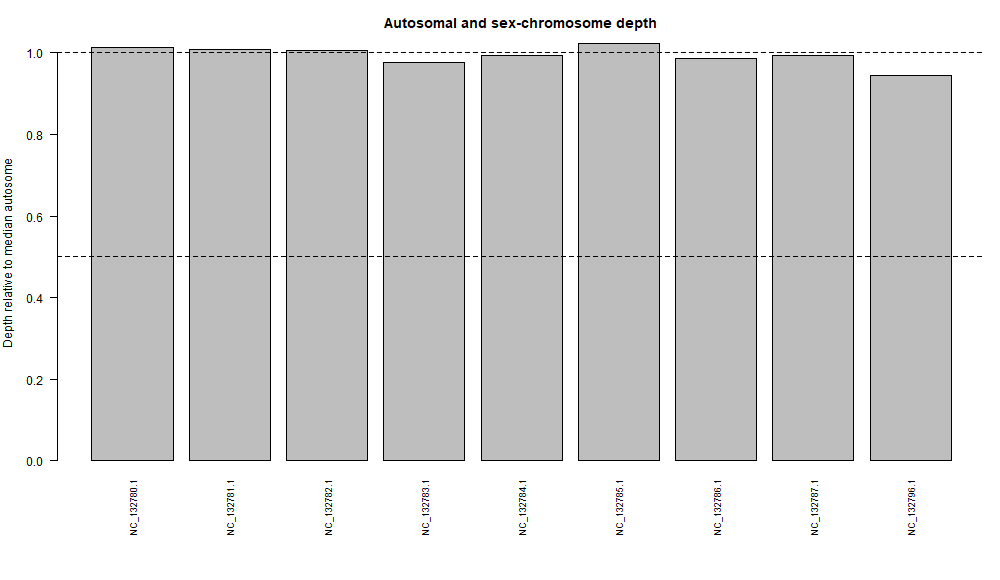

# Sex-Chromosome Dosage in the Red Fox (*Vulpes vulpes*)

### Name: Doreen Marie G. Puyat

**Study question:** Does the X-chromosome read depth, relative to the autosomes, show that the fox that supplied the WGS reads is XX-like or XY-like?

## Part A. Species and data

| Item | Value |
|---|---|
| Species | *Vulpes vulpes* (red fox), diploid, XX/XY |
| Assembly | VulVul3, [GCF_048418805.1](https://www.ncbi.nlm.nih.gov/datasets/genome/GCF_048418805.1/) (GenBank GCA_048418805.1), assembly level: Chromosome |
| Assembly BioSample | SAMEA113398840 |
| WGS run | [SRR30752830](https://www.ncbi.nlm.nih.gov/sra/SRR30752830), experiment SRX26155532 |
| WGS BioSample | [SAMN43533643](https://www.ncbi.nlm.nih.gov/biosample/SAMN43533643), isolate RM_S13-1169 |
| BioProject | PRJNA1158265 |
| Library | WGS, GENOMIC, RANDOM, PAIRED, Illumina NovaSeq 6000, 150 bp, 51.4M spots, 15.5 Gb |
| Sex of WGS donor | Female (BioSample metadata) |
| Same donor? | No (assembly isolate BD-2025, reads isolate RM_S13-1169) |


## Part B. Galaxy workflow

1. Created history `Sex_Dosage_Vulpes_vulpes` at usegalaxy.org.
2. Uploaded the reference by URL (type fasta): `https://ftp.ncbi.nlm.nih.gov/genomes/all/GCF/048/418/805/GCF_048418805.1_VulVul3/GCF_048418805.1_VulVul3_genomic.fna.gz`
3. Downloaded SRR30752830 with Faster Download and Extract Reads in FASTQ (paired, fastqsanger.gz).
4. FastQC v0.12.1: 51,410,667 read pairs, 0 poor-quality reads, read length 151, per-base quality green. No trimming was needed.
5. Map with BWA-MEM 0.7.19+galaxy1: reference from history (the same VulVul3 FASTA), paired collection, default settings.
6. Samtools sort 2.0.8: sorted by coordinate.
7. Samtools coverage 1.22+galaxy3: tabular output, minimum mapping quality 20, minimum base quality 20, no pooling (one individual).
8. Downloaded the output as `chromosome_coverage.tsv`.


## Part C. Chromosome groups

File: [`chromosome_groups.csv`](chromosome_groups.csv)

| rname | Group | Reason |
|---|---|---|
| NC_132780.1 to NC_132787.1 | A | Chromosomes 1 to 8 in the NCBI sequence report (assembled molecules) |
| NC_132796.1 | X | Labeled X in the NCBI sequence report (122,725,035 bp) |

The names were copied from the rname column of chromosome_coverage.tsv and checked against the NCBI sequence report. Chromosomes 9 to 16 were not used, because at least five autosomes are required. Unplaced scaffolds (NW_...), mitochondrial DNA, and alternate haplotypes were excluded. No Y is annotated in this assembly.

## Part D. R analysis

- Script: [`sex_depth_analysis.R`](sex_depth_analysis.R) (run with `Rscript sex_depth_analysis.R`)
- Inputs: `chromosome_coverage.tsv`, `chromosome_groups.csv`
- Outputs: `results/chromosome_relative_depth.csv`, `results/sex_inference.txt`, `results/chromosome_depth.png`

```r
[# Sex-chromosome dosage from whole-genome DNA read depth
cov <- read.delim("chromosome_coverage.tsv", comment.char = "",
                  check.names = FALSE, stringsAsFactors = FALSE)
names(cov)[1] <- "rname"
if (!"meandepth" %in% names(cov)) stop("Missing meandepth column")

key <- read.csv("chromosome_groups.csv", stringsAsFactors = FALSE)
if (!all(c("rname", "group") %in% names(key))) stop("Bad key columns")
key$rname <- trimws(key$rname)
key$group <- toupper(trimws(key$group))
if (anyDuplicated(key$rname)) stop("Repeated rname in key file")
if (!all(key$group %in% c("A", "X", "Y", "Z", "W")))
  stop("Use only A, X, Y, Z or W in the group column")

x <- merge(key, cov[, c("rname", "meandepth")],
           by = "rname", all.x = TRUE, sort = FALSE)
x$meandepth <- suppressWarnings(as.numeric(x$meandepth))
if (anyNA(x$meandepth)) stop("Missing depths: check rname matches")
if (any(x$meandepth < 0)) stop("Negative depth is not valid")
if (sum(x$group == "A") < 5) stop("Label at least 5 autosomes")
if ("X" %in% x$group && "Z" %in% x$group)
  stop("Choose either an XY or a ZW species, not both")

if (sum(x$group == "X") == 1 && !any(x$group == "Z")) {
  target <- "X"
  one_copy <- "XY-like"
  two_copies <- "XX-like"
} else if (sum(x$group == "Z") == 1 && !any(x$group == "X")) {
  target <- "Z"
  one_copy <- "ZW-like"
  two_copies <- "ZZ-like"
} else stop("Label exactly one X or exactly one Z chromosome")

A <- median(x$meandepth[x$group == "A"])
if (!is.finite(A) || A <= 0) stop("No usable autosomal coverage")
x$relative_depth <- x$meandepth / A
ratio <- x$relative_depth[x$group == target]
call <- if (ratio >= 0.80) two_copies else if (ratio <= 0.65)
  one_copy else "Ambiguous"
if (A < 1) call <- "Inconclusive: very low autosomal depth"

partner <- if (target == "X") "Y" else "W"
partner_ratio <- if (partner %in% x$group)
  x$relative_depth[x$group == partner][1] else NA_real_

dir.create("results", showWarnings = FALSE)
write.csv(x, "results/chromosome_relative_depth.csv", row.names = FALSE)
png("results/chromosome_depth.png", width = 1000, height = 580)
par(mar = c(8, 4, 3, 1))
barplot(x$relative_depth, names.arg = x$rname, las = 2,
        ylab = "Depth relative to median autosome",
        main = "Autosomal and sex-chromosome depth", cex.names = 0.75)
abline(h = c(0.5, 1.0), lty = 2)
dev.off()

summary <- c(paste("Median autosome depth:", round(A, 3)),
             paste(target, "/ A ratio:", round(ratio, 3)),
             paste(partner, "/ A ratio:", round(partner_ratio, 3)),
             paste("Dosage interpretation:", call),
             "Compare with BioSample sex and discuss limitations.")
writeLines(summary, "results/sex_inference.txt")
cat(paste(summary, collapse = "\n"), "\n")]
```


## Part E. Results and interpretation

| Result | Value |
|---|---|
| Median autosomal depth | 5.809 |
| X:A ratio | 0.944 |
| Y:A ratio | NA (no Y in the key) |
| Interpretation | XX-like |

| rname | Group | Mean depth | Relative depth |
|---|---|---|---|
| NC_132780.1 | A | 5.88981 | 1.0139 |
| NC_132781.1 | A | 5.85175 | 1.0074 |
| NC_132782.1 | A | 5.83963 | 1.0053 |
| NC_132783.1 | A | 5.66662 | 0.9755 |
| NC_132784.1 | A | 5.77803 | 0.9947 |
| NC_132785.1 | A | 5.94746 | 1.0239 |
| NC_132786.1 | A | 5.7288 | 0.9862 |
| NC_132787.1 | A | 5.77012 | 0.9934 |
| NC_132796.1 | X | 5.4808 | 0.9433 |



The X:A ratio of 0.944 is above the 0.80 cutoff and far from 0.5, so the WGS fox is XX-like. This agrees with the female sex recorded in BioSample SAMN43533643. Matching metadata is validation, and is not a replacement for the sequence evidence.

## Questions for the report

### 1. What species did you choose, and what evidence supports a diploid XX/XY or ZZ/ZWsystem?
I chose the red fox (*Vulpes vulpes*). It is a diploid mammal with an **XX/XY** sex-determination system (females are XX, males are XY). Two pieces of evidence support this:
- The VulVul3 assembly (GCF_048418805.1) sequence report lists chromosomes 1 to 16 and **X (NC_132796.1)**. This gives 16 autosomes plus X, consistent with a diploid fox.
- The red fox karyotype is 2n = 34 (16 autosome pairs plus the sex chromosomes), with a large metacentric X and a small acrocentric Y in males (Demirbaş & Baydemir, 2014). A Y-chromosome study in this species also supports a male-heterogametic XY system (Rando et al., 2019).

### 2. What are your assembly accession, WGS run, and both BioSample accessions? Are the donors the same?
I used the VulVul3 reference assembly, accession GCF_048418805.1 (GenBank GCA_048418805.1), whose BioSample is SAMEA113398840 (isolate BD-2025). The whole-genome sequencing reads came from run SRR30752830 (experiment SRX26155532), which belongs to BioSample SAMN43533643 (isolate RM_S13-1169). The donors are not the same. The assembly comes from one fox and the reads from another, so my result describes only the fox that supplied the reads.

### 3. Which sequences were used as autosomes and as X or Z? How did you verify their identities?
- Autosomes (A): NC_132780.1 to NC_132787.1 (chromosomes 1 to 8).
- X chromosome: NC_132796.1.

I checked the identities in the NCBI sequence report for GCF_048418805.1. It lists each numbered chromosome next to its RefSeq name, and the row named X is NC_132796.1. I also confirmed that the same names appear in the `rname` column of `chromosome_coverage.tsv`. Unplaced scaffolds (NW_), mitochondrial DNA, and alternate haplotypes were not used.

### 4. What are the median autosomal depth, X:A or Z:A ratio, and inferred sex-chromosome complement?
- Median autosomal depth: 5.809
- X:A ratio: 0.944
- Inferred complement: XX-like

The X:A ratio of 0.944 is above the 0.80 cutoff and far from the 0.5 expected for a single X.

### 5.  Does your result agree with the recorded sex of the WGS donor, if reported? Explain any discrepancy or uncertainty.
Yes, the result agrees. BioSample SAMN43533643 records the WGS fox as female, and the data show XX-like depth. This match is only validation. The call itself rests on the read-depth evidence.

Sources of uncertainty:
- The X ratio is slightly below 1.0, which can come from repeats, mapping bias, or pseudoautosomal regions.
- Depth is only about 6x, so ratios are somewhat noisy.
- No Y chromosome was used, so the call relies on the X:A ratio alone.
- The script's cutoffs are teaching guidelines, not diagnostic thresholds.

### 6. Why is a chromosome-level assembly alone insufficient for a reliable read-depth sex inference?
An assembly is a single consensus sequence. It shows which chromosomes exist, but not how many copies of each one a particular animal carries. Chromosome length does not reveal the sex of the animal either. Only sequencing reads from one individual can show this: if the X has the same read depth as the autosomes, that animal has two copies (XX), and if it has about half, it has one copy (XY). The assembly donor may also be a different animal from the one that supplied the reads, as in this exercise.

## Limitations

- The assembly donor and the WGS donor are different foxes, so the result describes only the WGS fox.
- Depth is about 6x, so ratios are noisier than at high coverage.
- Repeats, mapping bias, and pseudoautosomal regions can shift the X:A ratio (0.944 rather than 1.0).
- No Y chromosome was used, so the call rests on the X:A ratio alone.
- The script's cutoffs are teaching guidelines, not diagnostic thresholds.
- Only 8 of 16 autosomes were used.

## References

- NCBI Datasets: https://www.ncbi.nlm.nih.gov/datasets/genome/
- NCBI SRA: https://www.ncbi.nlm.nih.gov/sra
- Galaxy: https://usegalaxy.org/u/doreenmariepuyat/h/sex-dosage-vulpes-vulpes
- - Demirbaş Y, Baydemir NA. (2014). Karyotype and presence of B-chromosomes in red fox from Central Anatolia. *Hacettepe Journal of Biology and Chemistry* 42(3): 383-386. https://hjbc.hacettepe.edu.tr/journal/volume-42/issue-3/karyotype-and-presence-of-b-chromosomes-in-red-fox-from-central-anatolia/index.html
- Rando HM, Wadlington WH, Johnson JL, Stutchman JL, Trut LN, Farré M, Kukekova AV. (2019). The red fox Y-chromosome in comparative context. *Genes* 10(6): 409. https://doi.org/10.3390/genes10060409
